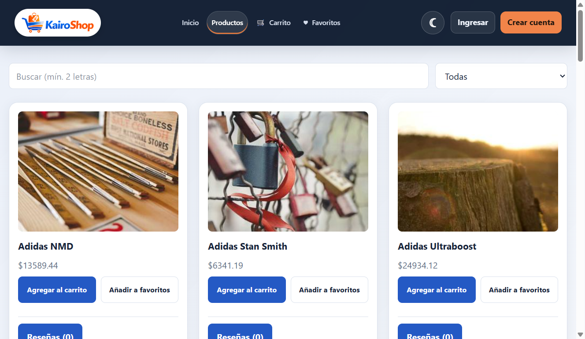
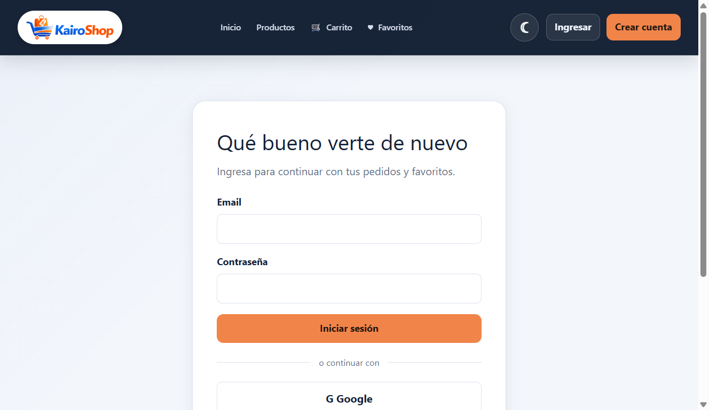

<p align="center">
	
</p>

# KairoShop

E-commerce con panel de administración, hecho con React, TypeScript, Firebase (Auth y Firestore, plan gratuito Spark) y AWS S3. Una función serverless en Vercel firma las subidas de imágenes.

**Demo en producción:** [proyecto-m5-caceres-diego.vercel.app](https://proyecto-m5-caceres-diego.vercel.app/)

## Capturas

**Catálogo**



**Ingreso**



## Funcionalidades

- **Cliente:** catálogo con búsqueda (debounce) y filtro por categoría, paginación, favoritos, carrito persistente, checkout con pago simulado, historial de pedidos y reseñas.
- **Administrador:** CRUD de productos con subida de imágenes, gestión de estados de órdenes y dashboard con métricas.
- **Autenticación:** registro y login con email y con Google, sesión persistente, rutas protegidas y roles `customer` y `admin`.

## Stack

| Área | Tecnología |
|---|---|
| Frontend | React 19, TypeScript, Vite, React Router, Tailwind CSS, Recharts |
| Datos y auth | Firebase Auth y Firestore |
| Imágenes | AWS S3 con POST prefirmado |
| Serverless | Vercel Function (`api/presign-upload.ts`) |
| Tests | Vitest, Testing Library, jsdom |

## Arquitectura

- `src/types`: contratos del dominio (productos, órdenes, reseñas y usuarios).
- `src/services`: adaptadores de Firestore, Auth, pago simulado y subida a S3, más los converters de documentos.
- `src/contexts`: estado global por dominio (Context, Provider, Reducer y hook).
- `src/components`: UI reutilizable. `src/pages` compone las vistas. El panel admin usa `AdminLayout`, distinto del layout de cliente.
- `src/routes`: rutas con lazy loading y guards `RequireAuth` y `RequireAdmin`.
- `api/presign-upload.ts`: valida el ID token de Firebase, comprueba el rol admin y devuelve un POST prefirmado de S3.
- `firestore.rules`: autorización en Firebase. Los guards del router son solo UX, no una barrera de seguridad.
- `scripts`: seed de categorías y productos de ejemplo.

## Puesta en marcha

1. Copia `.env.example` a `.env` y completa la configuración de Firebase. En PowerShell: `Copy-Item .env.example .env`.
2. Ejecuta `npm install` y `npm run dev`.
3. Opcional: `npm run seed` carga productos de ejemplo.

Para probar la subida de imágenes en local, usa `vercel dev` o define `VITE_UPLOAD_API_URL` con la URL de la función desplegada.

### Scripts

| Comando | Acción |
|---|---|
| `npm run dev` | Servidor de desarrollo. |
| `npm run build` | Chequeo de tipos y build de producción. |
| `npm run lint` | ESLint. |
| `npm run test` | Tests con Vitest. |
| `npm run test:coverage` | Tests con reporte de cobertura. |
| `npm run seed` | Carga datos de ejemplo en Firestore. |

## Tests

La suite cubre reducers, hooks, providers de Auth y productos, guards de rutas, checkout, servicios de órdenes y upload, converters y componentes. Se ejecuta con `npm run test` y la cobertura con `npm run test:coverage`.

## Roles y seguridad

El registro asigna siempre `customer`: no se acepta un rol desde el navegador ni se infiere del email. Para habilitar una cuenta admin, asigna `role: "admin"` al documento `users/{uid}` desde Firebase Console.

El checkout (`createOrder`) corre en una transacción de Firestore: lee precio y stock actuales, descuenta stock y crea la orden. Las reglas limitan a un cliente a bajar `stock` y a actualizar `rating` y `ratingCount`, y exigen `userId` propio, estado `pending` y `createdAt` del servidor.

**Limitación del plan gratuito:** sin backend, las reglas no pueden recorrer los ítems de una orden para recalcular el total, así que un cliente malicioso podría enviar un total distinto. Cerrar ese hueco requiere Cloud Functions (plan Blaze). Lo mismo aplica al promedio de ratings, que se actualiza desde el cliente en la misma transacción que la reseña.

### Subida de imágenes

Las imágenes de producto se suben directo a S3 con un POST prefirmado:

1. El cliente valida tipo y tamaño y llama a `api/presign-upload` con su ID token.
2. La función verifica el token con Firebase Auth, lee `users/{uid}` con ese mismo token (así deciden las reglas de Firestore) y firma solo para admins.
3. La clave del archivo la genera el servidor (UUID). La política firmada limita el tipo de imagen y el tamaño a 5 MB, y expira a los 5 minutos.

### Variables de entorno

| Variable | Dónde | Descripción |
|---|---|---|
| `VITE_FIREBASE_*` | Cliente | Configuración pública de Firebase. No son secretos. |
| `VITE_UPLOAD_API_URL` | Cliente | URL del firmador si está en otro dominio. Vacío usa `/api/presign-upload`. |
| `AWS_ACCESS_KEY_ID`, `AWS_SECRET_ACCESS_KEY` | Servidor | Credenciales IAM. Nunca con prefijo `VITE_`. |
| `S3_REGION`, `S3_BUCKET`, `S3_PUBLIC_BASE_URL` | Servidor | Bucket y URL pública de lectura. |
| `FIREBASE_API_KEY`, `FIREBASE_PROJECT_ID` | Servidor | Para validar el token y consultar el rol. |
| `ALLOWED_ORIGIN` | Servidor | Origen de la app, para CORS. |

Usa un usuario IAM con permiso `s3:PutObject` solo sobre `products/*`. El bucket debe permitir POST desde el dominio de la app (CORS) y lectura pública de `products/*`. El archivo `.env` está ignorado por Git.

## Pedidos y pago simulado

Los estados son `pending`, `processing`, `completed` y `cancelled`. El checkout valida una tarjeta simulada (no se cobra nada; `4000 0000 0000 0002` simula un rechazo), crea la orden en `pending` y guarda solo los últimos 4 dígitos. El admin cambia el estado desde su panel y el cliente ve el detalle y el historial en "Mis pedidos".

## Analíticas, paginación y reseñas

El dashboard muestra conteos agregados (`getCountFromServer`, `getAggregateFromServer`) y gráficos con ingresos por día y productos más vendidos sobre las últimas 200 órdenes no canceladas. El catálogo usa `onSnapshot` en la primera página y pagina con `limit()` y `startAfter()`. Las reseñas viven en la colección `reviews` y el promedio se guarda en el producto.

## Despliegue

El frontend y la función de firma se despliegan en Vercel, conectado al repositorio. Las variables de entorno se configuran en el panel de Vercel. Las reglas e índices de Firestore se publican con Firebase CLI:

```sh
firebase deploy --only firestore:rules,firestore:indexes
```

`vercel.json` redirige todas las rutas a `index.html` para que funcione el router del cliente.

Antes de cada release, completa la [checklist de producción](production-checklist.md).
